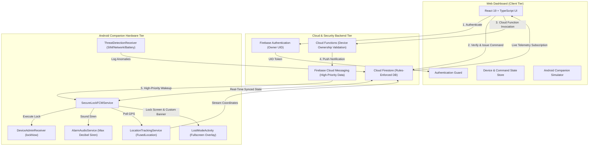
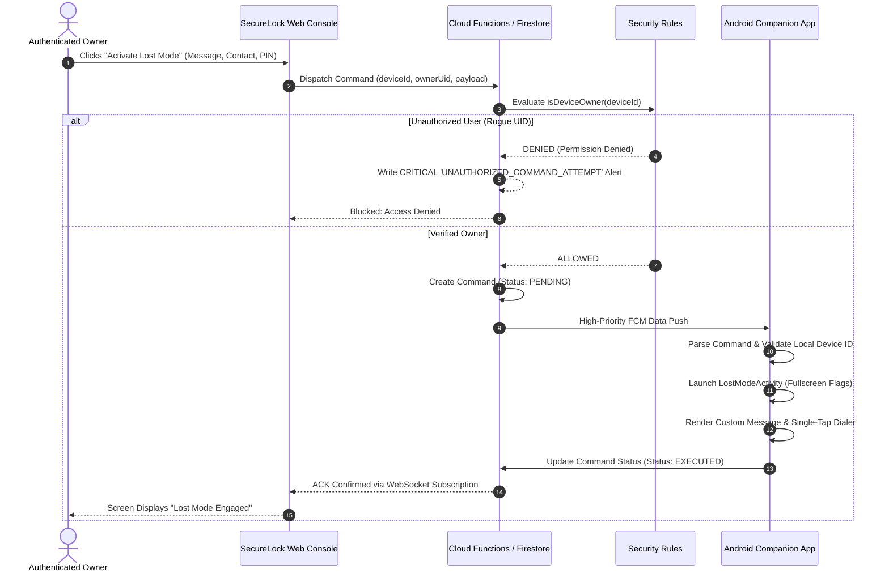

# SecureLock System Architecture & Security Specification

SecureLock is an enterprise-grade cybersecurity system designed to allow authenticated owners to remotely monitor, locate, and safeguard their own Android smartphones from a web dashboard.

---

## 1. High-Level Architecture Overview



---

## 2. Remote Command & Ownership Verification Flow

Every sensitive remote operation (such as activating Lost Mode or triggering a remote screen lock) strictly enforces authorization and device ownership before execution:



---

## 3. Database Schema Design (Cloud Firestore)

### `users/{userId}`
Stores registered owner account metadata:
```json
{
  "uid": "usr-cyber-owner-01",
  "email": "owner@domain.com",
  "displayName": "Chief Defense Officer",
  "registeredAt": "2026-10-15T18:00:00Z",
  "lastLoginAt": "2026-10-15T22:50:00Z"
}
```

### `devices/{deviceId}`
Stores hardware specifications, telemetry, and Lost Mode state:
```json
{
  "deviceId": "dev-pixel8-9921",
  "ownerId": "usr-cyber-owner-01",
  "deviceName": "Google Pixel 8 Pro",
  "status": "online", // "online" | "offline" | "lost"
  "lastSeen": "2026-10-15T22:54:10Z",
  "fcmToken": "fcm_token_string",
  "lostMode": false,
  "lostModeMessage": "This smartphone is lost. Please contact the owner.",
  "recoveryContact": "+1 (555) 019-2834",
  "recoveryNotes": "Reward offered upon safe return.",
  "devicePin": "1234",
  "alarmActive": false,
  "specs": {
    "model": "Pixel 8 Pro",
    "manufacturer": "Google",
    "osVersion": "Android 14 (API 34)",
    "apiLevel": 34,
    "securityPatchLevel": "2026-10-05",
    "deviceAdminEnabled": true
  },
  "battery": {
    "level": 84,
    "isCharging": false,
    "temperature": 31.4,
    "health": "GOOD"
  },
  "location": {
    "latitude": 37.774929,
    "longitude": -122.419416,
    "accuracy": 6.2,
    "address": "742 Market Street, San Francisco, CA",
    "timestamp": "2026-10-15T22:53:00Z"
  }
}
```

### `devices/{deviceId}/commands/{commandId}`
Command queue for remote control dispatch:
```json
{
  "commandId": "cmd-89211",
  "deviceId": "dev-pixel8-9921",
  "ownerId": "usr-cyber-owner-01",
  "type": "ACTIVATE_LOST_MODE",
  "status": "EXECUTED", // "PENDING" | "DISPATCHED" | "EXECUTED" | "FAILED"
  "payload": {
    "customMessage": "Emergency lost device",
    "recoveryContact": "+1 (555) 019-2834"
  },
  "createdAt": "2026-10-15T22:54:00Z",
  "executedAt": "2026-10-15T22:54:01Z"
}
```

### `securityEvents/{eventId}`
Immutable audit trail and smart threat detection records:
```json
{
  "eventId": "evt-sec-9081",
  "deviceId": "dev-pixel8-9921",
  "deviceName": "Google Pixel 8 Pro",
  "ownerId": "usr-cyber-owner-01",
  "eventType": "UNAUTHORIZED_COMMAND_ATTEMPT",
  "severity": "CRITICAL", // "CRITICAL" | "HIGH" | "MEDIUM" | "LOW"
  "timestamp": "2026-10-15T22:45:00Z",
  "description": "Rogue command blocked: caller UID does not match registered device owner.",
  "status": "INVESTIGATING",
  "integrityHash": "sha256-a94f82c3d4e8b10f2791cc44a982"
}
```

---

## 4. Cryptographic Integrity & Anti-Hijacking Guard

1. **Owner-Scoped Firestore Security Rules**:
   - `match /devices/{deviceId}` prevents read/write access unless `request.auth.uid == resource.data.ownerId`.
   - Creation of new devices requires `request.resource.data.ownerId == request.auth.uid`.
   - Update operations strictly forbid modifying the `ownerId` field (prevents ownership takeover).
2. **Immutable Audit Trail**:
   - The `securityEvents` collection allows `create` and `read` for the verified owner, but `update` and `delete` rules are explicitly set to `if false;`. Once written, threat records cannot be tampered with or purged by any client.
3. **Double Verification on Cloud Functions**:
   - Server-side callable Cloud Functions independently query the Firestore document to confirm ownership before triggering FCM push packets.
